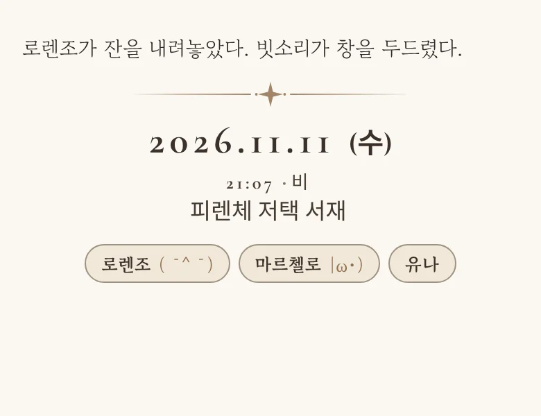
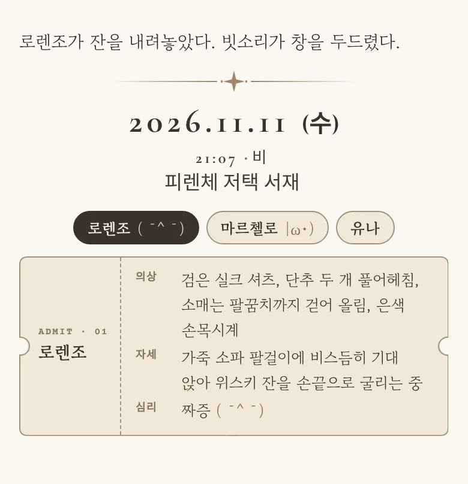
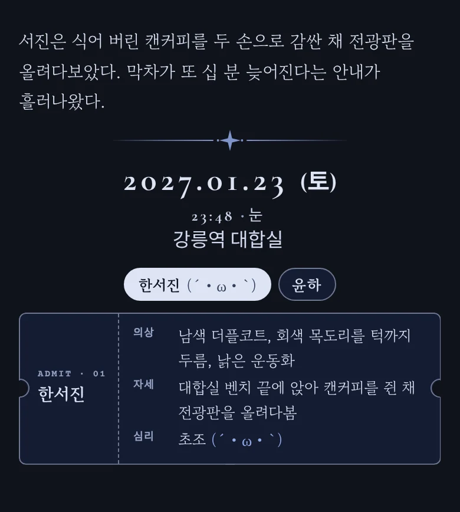
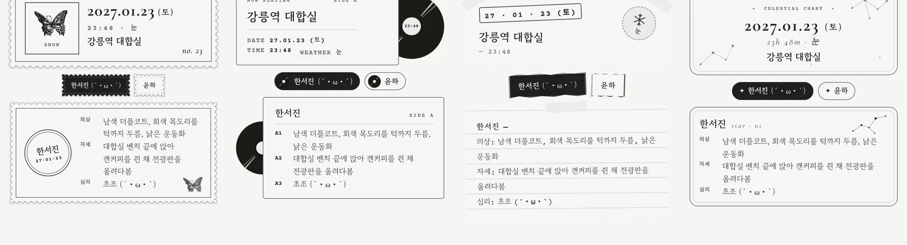
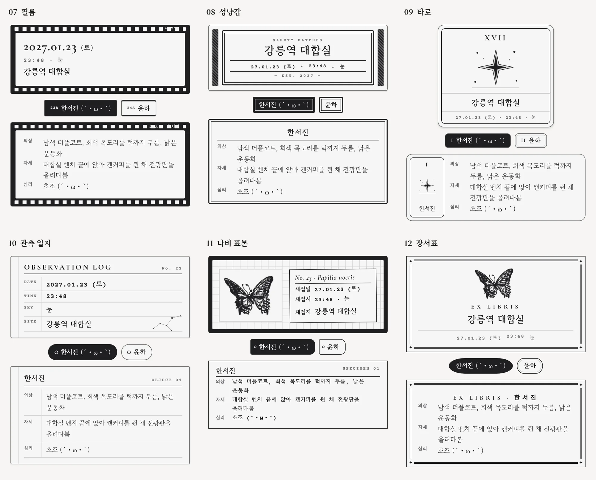
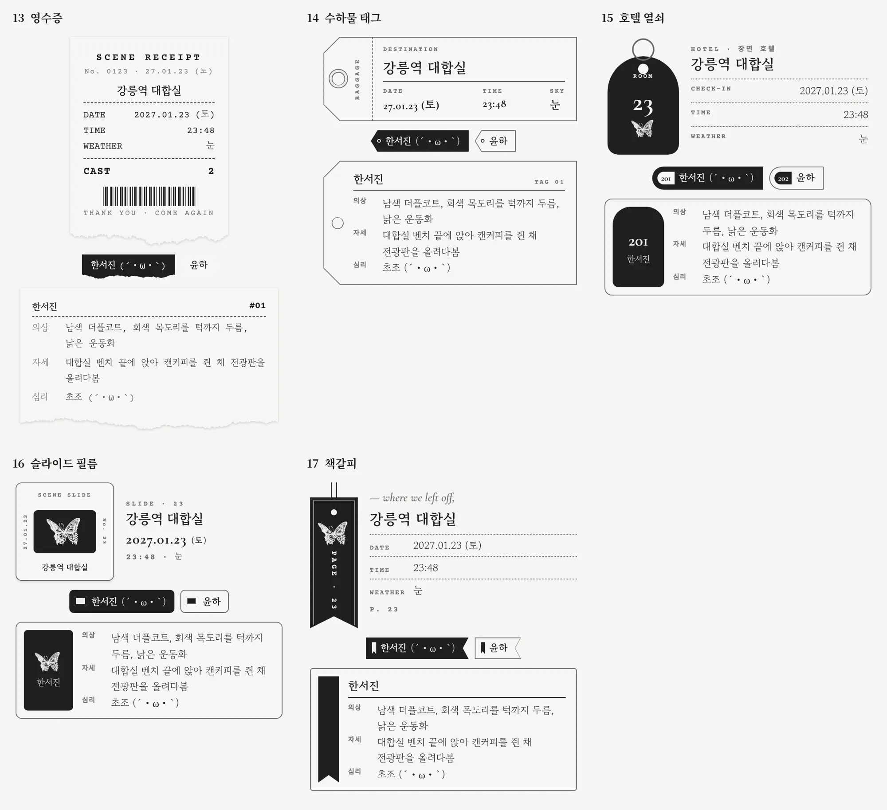
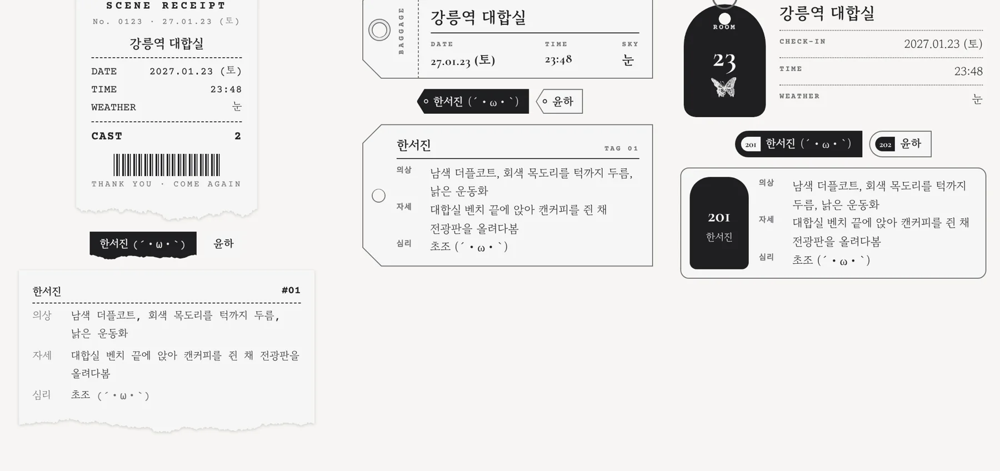
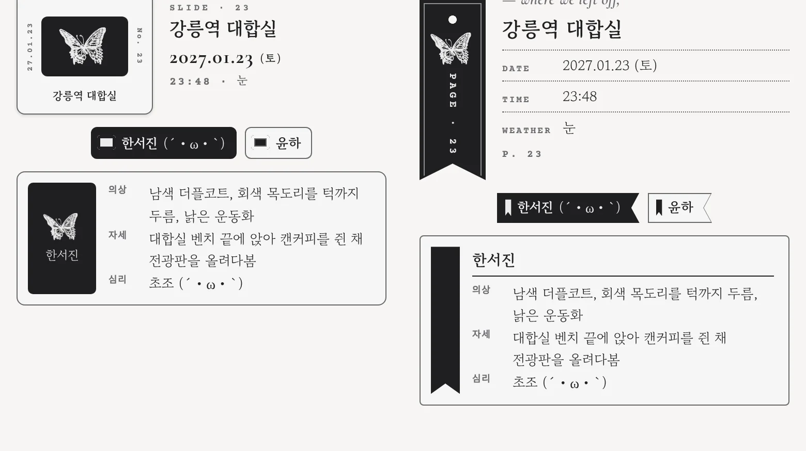
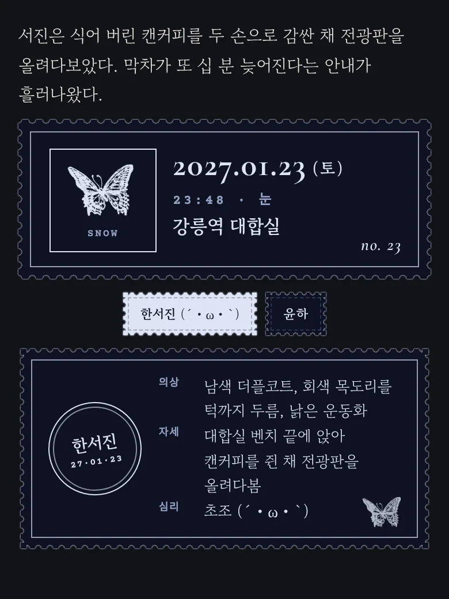
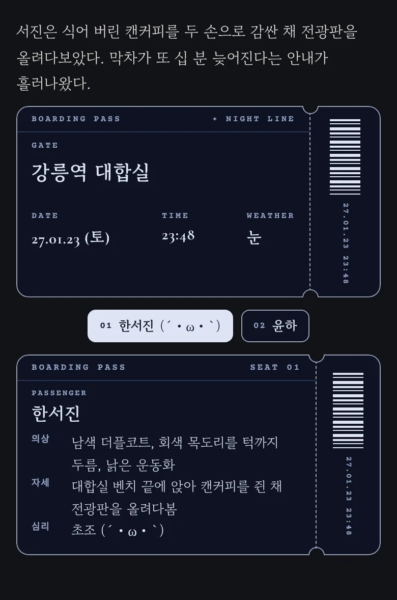

# 시공간 카드 상태창 (marinara-rp-timecard)

[Marinara Engine](https://github.com/Pasta-Devs/Marinara-Engine)용 개인 확장입니다.
RP 응답에 들어 있는 `§RP | 날짜 | 시간 | 장소 | 날씨§` 태그를 날짜 카드로 바꿔 보여 주고, 태그 바로 아래에 있는 인물 상태 줄을 작은 버튼과 티켓으로 정리합니다.
메시지 원문은 바꾸지 않고 화면에 보이는 모습만 바꿉니다.

> 비공식 확장입니다. Marinara Engine·Pasta-Devs와 관련이 없습니다. 예시 인물은 모두 지어낸 것입니다.

| 평소 (접힘) | 이름을 눌렀을 때 | 밤하늘 색감 |
| --- | --- | --- |
|  |  |  |

## 기능

- **날짜 카드**: 태그의 날짜·시간·장소·날씨를 카드로 보여 줍니다. 태그가 응답 첫 줄에 있어도, 마지막 줄에 있어도 됩니다.
- **인물 상태**: 태그 바로 아래의 `이름: 의상 | 자세 | 심리` 줄을 읽습니다.
  - 평소에는 **이름과 카오모지만** 버튼으로 보여 줘서, 의상·자세가 길어도 메시지가 길어지지 않습니다.
  - 이름을 누르면 그 인물의 의상·자세·심리가 티켓 모양으로 펼쳐집니다. 다시 누르면 접힙니다.
  - 이름은 무엇이든 됩니다. 칸은 2개(의상 | 자세)도 3개도 됩니다. 한 장면에 최대 12명까지 됩니다.
  - 카오모지 안에 `|`가 있어도 깨지지 않습니다. 세 번째 칸부터는 끝까지 심리로 읽습니다.
- **모양·색감**: 카드의 날짜를 누르면 모양 53가지와 색감 7가지를 고를 수 있습니다. 인물 상태도 같은 색감을 따릅니다. 고른 값은 이 기기의 모든 채팅방에 적용됩니다.
- **빈티지 소품 17가지**: 소인 우표 · LP 슬리브 · 스크랩북 · 별자리 차트 · 탑승권 · 엽서 · 필름 · 성냥갑 · 타로 · 관측 일지 · 나비 표본 · 장서표 · 영수증 · 수하물 태그 · 호텔 열쇠 · 슬라이드 필름 · 책갈피. 날짜 카드와 인물 상태가 같은 소품 모양으로 함께 바뀝니다. 빈티지 소품 카드는 카드 아무 곳이나 누르면 모양·색감 창이 열립니다.
- 날씨에 따라 그림이 움직이고, 기기의 '동작 줄이기' 설정을 따릅니다.

## 빈티지 소품

<p>
  
  
  
  
  
</p>
<p>
  
  
</p>

나비 그림은 [말랑 홈](https://github.com/tlsiddl/mallang-home)의 나비를 썼습니다.

## 설치

마리나라의 깃허브 확장 관리자에 이 저장소 주소를 넣으면 됩니다.

```
https://github.com/tlsiddl/marinara-rp-timecard
```

직접 넣으려면 `personal-extension` 폴더(`manifest.json`, `extension.js`, `extension.css`)를 개인 확장으로 추가합니다.

필요한 글꼴은 마리나라 글꼴 설정에 등록해 주세요: Cormorant Garamond, Nanum Myeongjo, Gowun Batang, Courier Prime, Nanum Gothic Coding, IM Fell English. 없으면 비슷한 글꼴로 대신 나옵니다.

## 프롬프트 예시

시스템 프롬프트나 로어북에 아래처럼 넣으면 됩니다. `{{char}}` 줄은 등장인물 수만큼 늘리면 됩니다.

```
매 응답 마지막 줄에 정확히 1회:
§RP | YY-MM-DD (요일) | HH:MM | 현재 장소 | 현재 날씨§
{{char}}: 의상 | 자세 | 심리 카오모지
{{user}}: 의상 | 자세

직전 태그의 날짜·시간·장소·날씨를 계승하고, 작중 변화만 반영한다. 직전 태그가 없거나 형식이 잘못되었다면 위 형식대로 새로 생성한다. 시간은 실제 장면 진행에 맞춰 경과시킨다. 기본 약 5분이지만 이동·대기·장시간 활동은 더 많이 흐를 수 있다. 날씨는 맑음·흐림·비·눈·안개 등 짧게 표기한다. 현실 날짜·시간 사용 금지, 형식 변경 금지, 태그 뒤 추가 본문 금지. 유니코드 일반 이모지(😀, 😭 등) 출력 절대 금지. 카오모지는 NPC의 현재 감정을 나타내는 텍스트 기반 카오모지 각각 딱 1개만 단독 출력. {{language}}와 무관하게 태그는 항상 한국어로 출력한다. 태그는 메타데이터이며 캐릭터가 인식하는 본문이 아니다.
```

### 읽을 수 있는 형식

- 날짜: `26-11-11`, `2026-11-11`, `2026.11.11`, `2026년 11월 11일`, `261111` 등. 뒤에 `(수)`·`(수요일)`을 붙여도 됩니다.
- 시간: `21:07` (24시간)
- 인물 줄은 태그 **바로 다음 줄부터** 이어져야 합니다. 중간에 다른 글이 끼면 그 뒤는 본문으로 봅니다.
- 심리 칸 끝의 카오모지는 자동으로 떼어 내서 버튼에 보여 줍니다. (예: `짜증 (￣^￣)` → 버튼에 `(￣^￣)`)

## 바뀐 점

### 1.4.1
- 영수증 찢긴 끝을 손으로 뜯은 종이 결처럼 자연스럽게 바꿈

### 1.4.0
- 빈티지 소품 5가지 추가: 영수증 · 수하물 태그 · 호텔 열쇠 · 슬라이드 필름 · 책갈피
- 빈티지 인물 버튼에 브라우저 기본 테두리가 끼어들던 문제 수정

### 1.3.0
- 빈티지 소품 모양 12가지 추가 (날짜 카드 + 인물 상태가 같은 모양으로)
- 인물 상태 티켓의 홈 테두리가 1px 어긋나 삐져나오던 문제 수정

### 1.2.0
- 태그 아래 인물 상태 줄 지원 (접어 두기 + 티켓 펼침)
- 태그가 응답 마지막 줄에 있어도 인식
- `YY-MM-DD (요일)` 날짜 형식 지원
